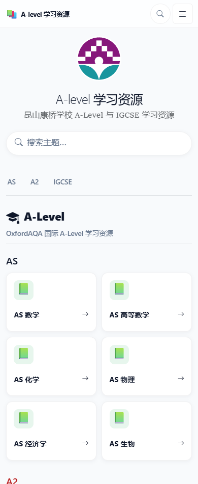
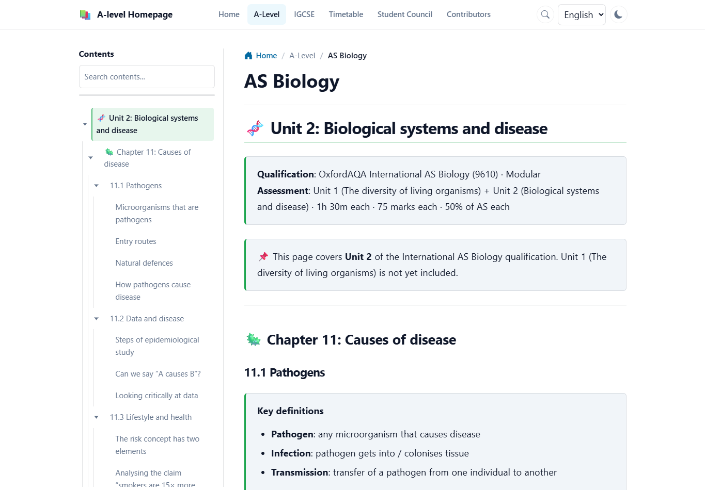
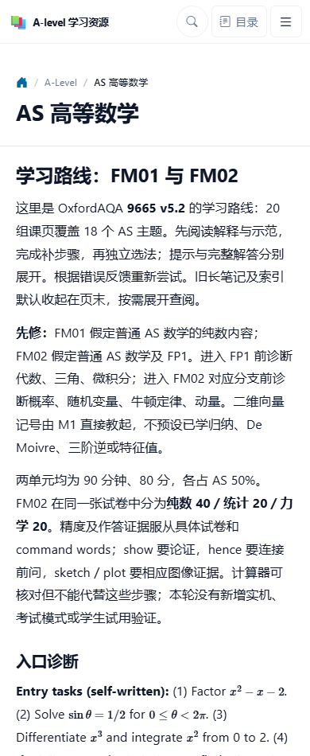
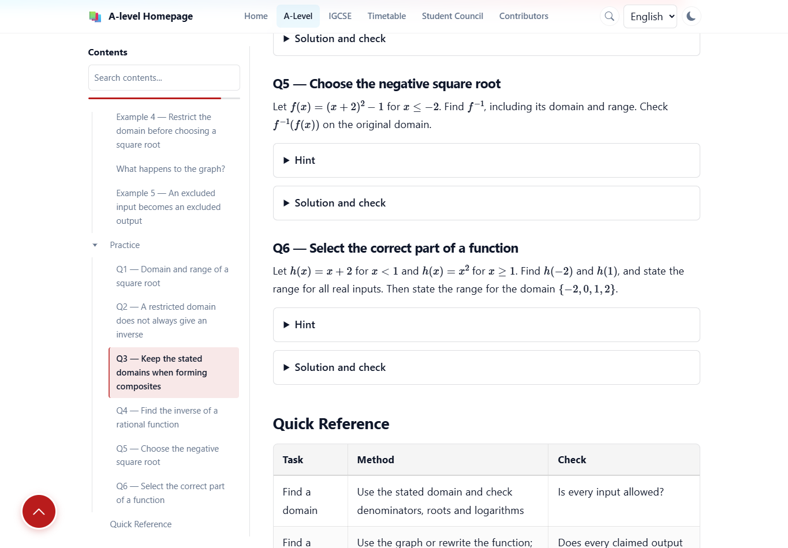
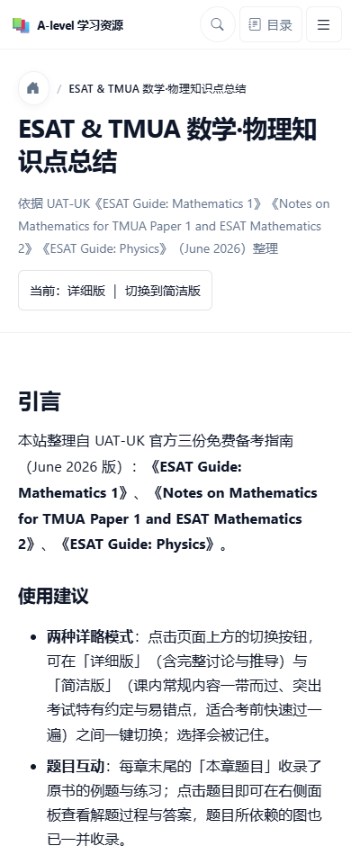
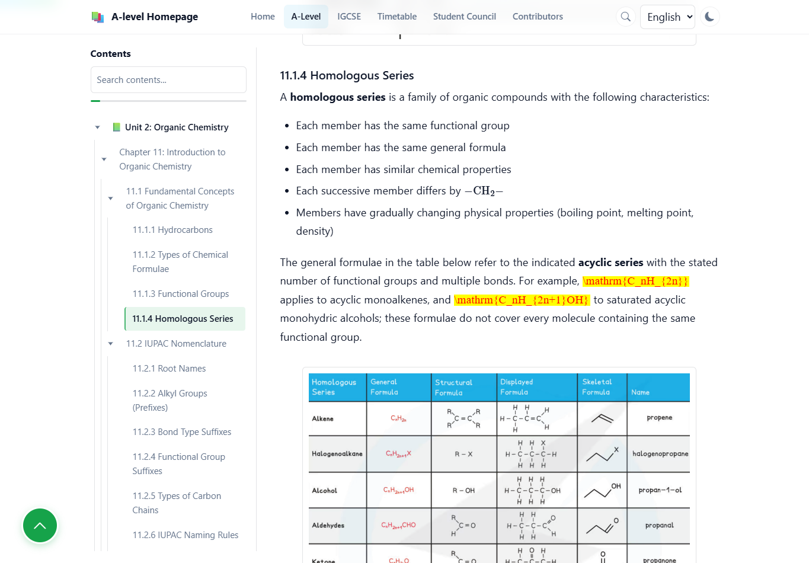

# 全站内容结构与可读性审查

日期：2026-10-22。主审版本：本地工作区，HEAD `1076347`，包括构建时已存在的未提交 MA03 数值方法改动。该改动保留，本报告不评价其正文质量。审查依据为 [课程内容长期标准](course-content-standard.md)与根 AGENTS；本轮只新增审查记录与证据，不改课程或发布。

## 1. 结论

当前网站已有不少可保留的讲解、图像、真题、练习和反馈，但这些内容处于不同成熟阶段。主要问题是：入口未让学生分清课程与参考资料，部分长笔记承担了课程入口的职责，新学习页的目标、独立任务和恢复路径也未完全接上。基础排版总体稳定，但 AS 化学确认有两处公式渲染失败；除修正这类直接阅读障碍，优先工作应是内容编辑与学习设计。

“参考资料”本身是正当用途。下文指出它们对初学者的支持边界，不把每份速查都判为不合格课程，也不建议把全部资料套成同一模板。

## 2. 范围与证据

| 检查层面 | 本轮实际覆盖 | 能支持的结论 |
| --- | --- | --- |
| 全量源文件盘点 | 325 个带站点元数据的源文件，其中学科与计算器 subjects 页面 292 个，含两种语言 | 文件、路由、层级、标题、表格与折叠结构；不等于通读全部正文 |
| 课程入口 | 首页 18 个目录项：17 个学科入口及 1 个计算器指南；连同现有译页共 31 个入口地址 | 入口角色、语言与内容范围的呈现；各科入口均在本轮检查 |
| 人工内容阅读 | 数学、IGCSE／AS 理科与经济、A2 科学三个分项；全部学科主入口及代表性正文，详见分项清单 | 完整入口与已读正文的结构判断；未读章节不继承样本结论 |
| 实际浏览器 | 39 个本地地址，1365px 桌面、390px 手机各检查一次，共 78 个基线视图；另做针对性截图与操作复查 | 实际首屏、目录、手机重排与公式；未在每个学习页运行所有交互 |
| 静态本地链接 | 扫描到 5861 条生成页面内的本地链接，未检出目标文件或静态锚点缺失 | 不能替代检查链接是否指向恰当的先修，也未覆盖外链可用性 |
| 线上对照 | 中文首页、中文 AS 数学、AS 高数中英文入口 | 区分已上线内容与本地改进，不是线上全站镜像审计 |

数据：[源文件清单](audit-assets/2026-10-22/source-inventory.csv)、[浏览器测量](audit-assets/2026-10-22/browser-measurements.csv)。初始预览尚未启动导致的 9 个加载失败，启动后全部重新检查成功，未计作网站缺陷。截图均为本轮获取并实际查看的原图；手机目录动画中途的截图已弃用，另存稳定状态。

**线上与本地确有差异：**线上中文 AS 数学仍是链接到英文笔记的主题目录，本地已有双语学习页与新入口；线上中文 AS 高数新地址返回 404，但线上中文首页实际链接到可访问的英文 AS 高数。此处是未发布译页的版本差异，不能误报为首页现有坏链接，也不能把本地样板当作线上已有。

考试时间表、学生会、贡献者等辅助区域已纳入源文件与链接盘点，本轮只看其导航和角色分工，不核验行政事实或个人资料。TMUA／ESAT 与计算器指南另作阅读结构抽查。未逐题验算全站、未重新认证各科官方范围，也未开展学生试用或完整无障碍符合性测试。

## 3. 各入口现在提供的是什么

以下描述是当前本地内容形态，不是官方范围完整性认证。

| 入口 | 当前主要形态 | 优先优化方向 |
| --- | --- | --- |
| IGCSE 数学 | Extension 英文要点与即时答案；中文定位目录 | 明确参考属性，先建立一个有解释与独立任务的主题样章 |
| IGCSE 物理 | 四组双语学习页，加单页复习笔记 | 保留新学习路线，分清其他笔记；补足具体目标的独立证据 |
| IGCSE 化学 | 英文提纲、表格与 quick checks；中文目录 | 纠正未经映射的完整性措辞，分离作答与答案 |
| IGCSE 生物 | 英文概念提纲、实验提示与 quick checks；中文目录 | 补机制推理、图表任务与反馈，保持资料用途清楚 |
| AS 数学 | 15 组双语主题页，本地已整理入口与相邻课导航 | 首次讲解密度、编号先修定位、综合与延后回顾 |
| AS 高数 | 20 组双语课页，旧笔记已收起 | 缩短入口说明，先给路线；逐目标核对推导与应用任务 |
| AS 物理 | 四组双语学习页，加单页复习笔记 | 精确的先修回补、图线边界等目标的独立练习 |
| AS 化学 | 一页英文有机笔记；无中文正文 | 范围声明与现有章节对应，另建初学入口与任务 |
| AS 生物 | 一页英文 Unit 2 长笔记；无中文正文 | 学习段、先修、作答与反馈路径，保留有用机制和图 |
| AS 经济 | 八份 PDF 思维导图的链接目录 | 标明资料身份和编号含义，建立情境应用与评价样章 |
| A2 数学纯数 | MA03 双语主题学习页与速查 | 独立题标题泄露、先修衔接、单元综合与回顾 |
| A2 数学力学 | MA05 双语学习页、速查与综合入口 | 保留建模解释；让诊断、重试真正针对同一困难 |
| A2 数学统计 | MA04 英文汇总参考笔记 | 密度／概率与检验选择的学习顺序、独立作答和反馈 |
| A2 高数纯数 | FM03／FP2 双语主题学习页 | 开篇术语密度、部分先修定位、跨主题完成路径 |
| A2 物理 | PH03 学习页与资料，PH04 部分学习页 | 精确先修恢复、可独立尝试的重试、可找到的综合任务 |
| A2 化学 | CH03 六组双语学习页、真题与诊断 | 初学主线与查题路线分工、图形反馈、英文任务保留 |
| A2 生物 | BL03–BL05 学习页、桥接与单元路线 | 机制目标的独立产出，长数据技能页的学习分段 |
| fx-CG50 | 中文分阶段指南与专题操作任务 | 保留阶段导航；长进阶页按操作目标给出明确完成段 |

TMUA／ESAT 不在上述学科卡片数内：它是详细／简洁两种模式的知识总结和题目资源，尚缺按考试与能力选择的短学习路线，见发现 7。

## 4. 优先发现

优先级用于本次内容修整：P1 影响学生对内容边界的判断或核心独立作答；P2 影响阅读、回补与学习连贯性。它们不是安全漏洞等级。

### 1. P1：首页把不同用途、范围和语言的内容呈现为同一种入口

**证据：**中文首页卡片只显示名称、图标和箭头。`_data/subjects.yml` 已写“仅 Unit 2”“PDF 导图”“英文参考”等说明，但共享卡片没有呈现 description／description_zh；缺少译页时直接使用英文地址。源码位置：[卡片组件](/D:/GitHub/Academic/_includes/subject_card.html:12)、[课程数据](/D:/GitHub/Academic/_data/subjects.yml:86)。线上首页也观察到此模式。

**影响：**学生点击“AS 化学”“AS 生物”“AS 经济”之前，无法从卡片知道接下来是部分英文笔记或 PDF 目录。页面内部的范围说明有用，但出现得较晚。

**建议：**卡片显示简短、准确的内容类型、实际范围与语言；先校准已有数据，再复用共享组件呈现。无需增加一套复杂分类系统。

### 2. P1：部分入口直接承载整单元笔记，缺少明确的学习段与完成点

**证据：**AS 生物入口的源文有 149 个标题，运行目录列 141 项；AS 化学目录列 110 项。它们既是入口又是长正文，没有独立的先修—学习—作答—反馈路线。手机目录已经折叠，不能把全部目录项误说成同时显示；问题仍在正文角色与学习段缺失。AS 化学开头声称覆盖 Unit 2 的有机与物理部分，而现有目录主体为有机章节，声明应与实际资产重新对照。[生物入口](/D:/GitHub/Academic/alevel/as-biology/index.md:12)、[化学范围声明](/D:/GitHub/Academic/alevel/as-chemistry/index.md:13)。

**影响：**学生能连续查资料，但要自己决定开始点、需要补什么、何处停下来检验。目录搜索只能定位词条，不能补足教学顺序。

**建议：**先给简短学习入口，保留长笔记作为参考；围绕真实概念转折完成样章与能力检查。按用途整理，不按每个小标题机械拆网页，也不因篇幅长就删除必要解释。

### 3. P2：入口说明、内部编号和重复使用建议挤占了学习主线

**证据：**本地 AS 高数手机首屏依次是内容数量、资格版本、两段先修与考试安排、作者验证说明、入口诊断；课程链接从源码第 33 行之后才出现。AS 数学代数仍用 L01、L02、L03、L05 组织正文，先修又指向这些未链接的编号；部分数学开篇把多个新定义、表示及规则压进几行。[高数开篇](/D:/GitHub/Academic/zh/alevel/as-further-mathematics/index.md:15)、[代数先修](/D:/GitHub/Academic/zh/alevel/as-mathematics/algebra.md:103)、[复数开篇](/D:/GitHub/Academic/zh/alevel/as-further-mathematics/complex-numbers-and-roots.md:20)。A2 科学样本也有多套路由、表格与维护措辞竞争的情况，详见分项报告。

**影响：**学生读到的是作者组织资料的方式，开始具体学习前先处理大量说明。新概念密集时，读者还要自行补出表示的含义与连接。

**建议：**首先给出主题、目的和开始动作；先修使用有意义的名称并直接定位。关键概念按对象或问题逐步建立，规则汇总留作后续速查。保留必要来源、题号与稳定锚点，把维护记录归入参考区域。

### 4. P1：部分“独立题”和“再尝试”提前暴露了被考查的判断

**证据：**MA03 函数独立题 Q5 的标题直接说“Choose the negative square root”；题目随后才要求学生求反函数。IGCSE 数学、化学、生物多处 quick check 与答案同一行。A2 物理电容课“分析与再尝试”在同一块内同时给出新题与完整时间平移结论；化学缓冲液也有同类重试直接说明应拒绝哪个模型的例子。[函数 Q5](/D:/GitHub/Academic/alevel/a2-mathematics/functions.md:314)、[IGCSE 自测](/D:/GitHub/Academic/igcse/mathematics/index.md:43)、[电容重试](/D:/GitHub/Academic/zh/alevel/a2-physics/capacitor-charge-and-discharge.md:358)。

**影响：**折叠答案并不能恢复已经由标题或相邻文字给出的关键判断；这些内容可以是示范，却不能用来证明学生独立选法或纠错成功。

**建议：**中性题号与题干先出现，提示和答案分别展开；重试题干独立于原题反馈。保留必要图示与替代文字，通过任务安排解决泄露。

### 5. P1：有学习目标与练习栏目，仍存在目标未被独立检验的缺口

**证据：**AS 高数几何分布明确要求推导均值和方差，但独立题主要让学生计算概率、参数和矩；A2 生物光合作用开篇承诺追踪电子、质子与碳，而样本中的独立题没有让学生重建膜上的电子／质子通路；AS 物理测量课的误差棒边界训练主要处于讲解与支架，后续独立题检验其他技能。[几何分布目标](/D:/GitHub/Academic/alevel/as-further-mathematics/geometric-distribution.md:19)、[光合作用目标](/D:/GitHub/Academic/zh/alevel/a2-biology/photosynthesis.md:20)、[测量的独立题](/D:/GitHub/Academic/alevel/as-physics/measurements-and-uncertainties.md:211)。

**影响：**学生可以完成现有任务，却仍未留下这些目标的独立产出。任务或折叠块数量不能排除这一问题；这也不是“所有目标都没有被检验”的结论。

**建议：**按长期标准逐目标建立讲解—独立任务—反馈对应表；先补上述具体缺口，再检查其他样章。保留原有应用题，让推导、建模、机制、数据解释分别得到相符的证据。

### 6. P2：回补、诊断、重试和跨主题复习尚未完全接通

**证据：**部分先修链接只返回整个 AS 目录；热力学要用 Hess 路径推理，入口先修检查主要检验焓变反向符号。MA05 有碰撞相关诊断却配了另一种速率目标的重试。AS 数学路线终点是回目录选主题，MA03、FM03 及 A2 物理／化学入口缺少明确定位的延后综合安排。[圆周运动先修](/D:/GitHub/Academic/zh/alevel/a2-physics/circular-motion.md:22)、[化学先修](/D:/GitHub/Academic/zh/alevel/a2-chemistry/index.md:46)、[MA05 重试](/D:/GitHub/Academic/alevel/a2-mathematics/mechanics/vectors-and-kinematics.md:409)、[AS 数学终点](/D:/GitHub/Academic/zh/alevel/as-mathematics/momentum.md:96)。

**影响：**链接可以正常打开，学生仍要自己判断回哪里补、做什么才能证明修复、隔一段时间怎样复查。换了技能的重试也不能代表原困难已经解决。

**建议：**错误与必要先修定位到具体学习段，配同目标的新任务；在单元完成处给出可执行的无方法标签综合题与后续回顾入口。保留已有的 AS 高数出口任务、MA05 综合问题和生物单元迁移，不重复造一套栏目或固定全站复习天数。

### 7. P2：TMUA／ESAT 和计算器进阶页需要更清楚的使用段落

**证据：**TMUA／ESAT 详细模式在 390px 视图下默认高度约 460000px，目录约 192 项；切换简洁模式后仍约 221000px。计算器进阶页有 56 个目录项。数值只是定位阅读范围的线索，不是学习时长或质量评分。计算器已经有较好的分阶段导航；TMUA 也已有模式切换与题目面板。[TMUA 开篇](/D:/GitHub/Academic/admissions/tmua-esat/index.html:15)、[计算器进阶](/D:/GitHub/Academic/alevel/fx-cg50/advanced/index.md:28)。

**影响：**全文总结适合查询，却没有充分回答“备考哪部分、今天完成哪项能力、掌握后去哪检查”。简洁显示减少文字，但没有自动形成学习路线。

**建议：**保留资料正文、题目面板和工具导航，在上层按考试／能力给出有限的学习段、先修、完成任务和下一步；再根据概念边界决定是否拆页，不按像素长度批量切割。

### 8. P2：部分图像反馈、替代描述和双语任务支持仍不充分

**证据：**AS 化学若干教学图只有 IMG 类描述；A2 化学酸碱 Q8 要求画曲线，反馈主要是文字说明；该页中文 Q5–Q7 未同时保留英文题干。生物数据技能解释了误差条，却缺少与该目标相符的独立读图样本。[AS 化学图像](/D:/GitHub/Academic/alevel/as-chemistry/index.md:126)、[酸碱中文题干](/D:/GitHub/Academic/zh/alevel/a2-chemistry/acids-bases-and-buffers.md:363)、[图像反馈](/D:/GitHub/Academic/zh/alevel/a2-chemistry/acids-bases-and-buffers.md:430)。这些是具体样本，不能据此推断所有图或译页都有问题。

**影响：**能读规则与能解释图形不是同一能力；图不能加载或使用辅助技术时，泛称 IMG 不能传达必要关系。中文理解支持也未必自然转化为独立英文表达。

**建议：**让反馈提供需要比较的标注图；替代描述传递必要关系而保留待作答的判断；保留英文任务，在确有需要的机制解释中逐步撤去英文句型支架。保留已有的生物综合写作与物理图线分析作为局部范例。

### 9. P1：AS 化学同系物段的两处通式没有正常显示

**证据：**桌面与手机均确认同系物段的烯烃、醇通式显示成红黄错误文本，MathJax 报 `Double subscripts: use braces to clarify`。[源码位置](/D:/GitHub/Academic/alevel/as-chemistry/index.md:60)。测量脚本在每个视图记录 4 个错误节点，这是两处公式的可视层与辅助 MathML 各记录一次，不是四处不同公式。

**影响与建议：**学生在定义段读到公式源码和错误标记，直接妨碍符号理解。优先修正这两处表达的源码与渲染，再在桌面和手机实际核验；本轮只定位，不修改课程。其余受查视图未检出 MathJax 错误，不代表未浏览的全部正文均已通过公式检查。

## 5. 已确认的优点与技术边界

- 本轮 78 个基线视图没有发现整页横向溢出；76 个没有记录到 MathJax 错误，另 2 个是 AS 化学的桌面／手机视图，详见发现 9。字体与行距在样本中可读。局部表格横向滚动、图内标签和深层目录仍需按任务评价，不能由此宣称全站可访问性达标。
- 手机目录可以用键盘打开，长目录默认有层级折叠。保留这一能力，内容整理时优先修目录层级与命名。
- MA05 建模、FM03 线性方程组、物理受力与 RC 实验、化学诊断表、生物综合写作和单元任务都有可复用的内容。修整应围绕缺口推进，避免把这些可靠资产一并重写。
- 本轮 Jekyll 构建通过；静态链接检查没有发现文件或锚点缺失。这些只支持技术与定位结论，不证明学科正确性或学生学习效果。

## 6. 建议修整顺序与验收

1. **先排除直接阅读障碍并校准入口承诺。** 修正 AS 化学公式；让卡片与课程入口明确内容类型、实际范围和语言，修正当前范围声明与资产不一致处。验收：公式实际可读，学生点击前后获得一致预期。
2. **修核心任务。** 优先处理函数题标题、RC／缓冲液重试、几何分布推导与光合作用机制任务。验收：审查者在提示关闭时独立完成，目标对应表能定位证据。
3. **建立可读样章。** 选择 AS 长笔记的一段与一个新课程中的压缩概念段，完成解释、先修、练习与反馈后再扩展。验收：仅凭声明的先修能追踪关键决策。
4. **接上恢复与复习。** 逐步用具体回补链接、同目标重试、单元综合和后续提取接替笼统建议。验收：能实际走通“错在哪里—回哪里—重做什么—稍后查什么”。
5. **最后统一编辑表现。** 整理编号、教师维护措辞、重复导航、图形反馈与英文输出支持。沿用共享布局和稳定锚点，按受影响页面做技术及实际阅读检查。

上述均为建议，未在本轮实施。后续课程修改按既有授权开展；标准中的内容审查、技术检查与学生试用分别记录，不从本次审查推断学习效果。

## 7. 分项证据与阅读清单

- [数学课程：8 项具体发现与逐页阅读清单](audit-2026-10-22-mathematics.md)。
- [IGCSE／AS 理科、数学与经济：8 项发现、完整入口阅读与物理样本](audit-2026-10-22-ig-as-sciences.md)。
- [A2 物理、化学、生物：8 项发现、26 页阅读清单及保留资产](audit-2026-10-22-a2-sciences.md)。

分项中的“未做浏览器／构建”描述各分项研究的边界；主审已完成本报告第 2 节列出的实际页面检查，不改变分项对未读正文的限制。旧审查、旧截图与历史学习反馈未作为本轮缺陷证据。
