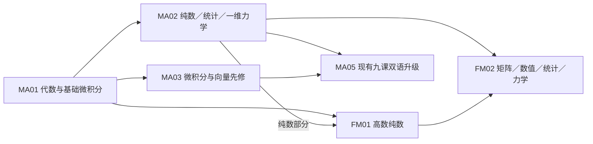

# MA05（M2）课程内容研究与双语升级设计

日期：2026-10-22。对象：OxfordAQA Mathematics **9660／MA05，A2 Unit M2**。本轮是研究与设计，不是新增课程、重新认证全部答案或发布。

配套研究：[AS 数学 MA01／MA02](research-ma01-ma02-course-content-2026-10-22.md)；[AS 高数 FM01／FM02](research-fm01-fm02-course-content-2026-10-22.md)。

## 1. 结论与范围锁定

1. 现有九节英文课已构成 M2.1–M2.7 路线；本轮未发现某个 M2 主主题整块空白。下一阶段应保留路线、补中文讲解和目标对应任务，再增加 AS 先修诊断与跨主题考查，不能把已有内容全部重做。
2. **新增明确需求是动量先修桥接。**M2 大纲要求熟悉 AS 和 P2 内容；2025 年 1 月 MA05 Q8 实际考了动量守恒、方向分支与碰撞能量。当前九课没有动量／冲量的独立复习任务链，只有回到 AS 数学的泛链接。应桥接 MA02 M1.4，并接入能量综合练习；这不是把恢复系数、二维碰撞等 FM 主题加入 MA05。
3. **精度要按试卷处理。**现有自拟课默认三位有效数字／角度一位小数；Jan 2025 卷首默认计算器最终答案为两位有效数字，题内又有三位有效数字、最接近整数角度、精确值等覆盖指令。自拟题可以保留自己的精度约定，但必须明确其身份，真题按该卷与该题处理，不能一律改成三位或两位。
4. MA05 不是 FM05。不得把斜面落点抛体、竖直非匀速圆周、弹性绳／恢复系数等高数内容写成 MA05 必考要求。

基线为本地 `350879e`；已核对本轮前取得的 `origin/main@483f65b` 与它的差异只涉及 IG／AS 物理，本文数学文件在两基线一致。此前[全站缺口盘点](audit-site-content-gaps-2026-10-22.md)提供入口分类，本报告进一步核对 M2 条目和一份配套真题。

## 2. 一手来源与实际阅读状态

| 编号 | 来源 | 本轮核查 |
| --- | --- | --- |
| S1 | [9660 当前资格页](https://www.oxfordaqa.com/qualification/international-as-and-a-level-mathematics-9660/) → [Specification](https://www.oxfordaqa.com/wp-content/uploads/2026/07/oxfordaqa-a-level-mathematics-specification.pdf) | PDF 正文为 **v5.2**，36 个 PDF 页面；§3.5，印刷 pp.27–30；§2、§4、§5.1 的结构／评价／代码。文件路径年月不当作版本号 |
| S2 | [MA05 Jan 2025 Question Paper，仓库存档](../../assets/pdf/fx-cg50/references/oxfordaqa-ma05-2025-january-question-paper.pdf) | 封面：21 January 2025，9660/MA05 Unit M2，90 分钟，80 分；24 个 PDF 页面；读 Q1–9 题干，视觉核对封面、Q7 与 Q9，部分图像未逐张复查 |
| S3 | [同卷 Mark Scheme，仓库存档](../../assets/pdf/fx-cg50/references/oxfordaqa-ma05-2025-january-mark-scheme.pdf) | 正文 Jan 2025，Version 1.0 Final，17 页；读取缩写表及 Q1–9 对应评分，重点检查方法、解释、分支和精度；本地为 OxfordAQA 文档副本，不伪称此次从官方服务器重新下载 |
| S4 | [9660 Command words](https://www.oxfordaqa.com/oaqaresources/maths/assessment/a-level-maths-command-words.pdf) | 4 页，核对 show、deduce、explain、interpret、sketch、solve、state 等任务含义 |
| S5 | [当前课程入口](../../alevel/a2-mathematics/mechanics.md)、[九课目录](../../alevel/a2-mathematics/mechanics/)、[原有制作审查](../mechanics-content-review.md) | 入口、九课范围／先修／任务与关键正文，非逐题全量复审。2026-10-02 的构建、图像和 67 例／71 练等结果是历史记录，没有冒充本轮重跑 |

当前资格仍为 9660；官网存在 9760 不代表本项目自动换纲。M2 是 A2 应用选项，和 S2 二选一；不是独立于 AS／P2 的零先修科目。允许电子／图形计算器不代表批准任何 CAS 或插件：试卷允许工具与具体机型操作验证分开记录；本轮未重测 fx-CG50 按键。

## 3. 官方条目—当前课程—教学决策

以下按 S1 §3.5 比对；“已有”只说明正文与任务确实存在，不认证每个例题和全部细项均无误。

| 大纲条目 | 核心能力及边界 | 当前落点 | 下一阶段决策 |
| --- | --- | --- | --- |
| M2.1 Mathematical modelling | 假设如何简化现实、支持方程、限制结论；particle、light、inextensible、smooth、gravity 分开解释 | [建模](../../alevel/a2-mathematics/mechanics/mathematical-modelling.md) | 保留分体受力和模型评价，补中文原因链与撤去术语提示的情境任务 |
| M2.2 Kinematics | 一／二／三维位置、速度、加速度；分量微积分与初始条件 | [向量运动学](../../alevel/a2-mathematics/mechanics/vectors-and-kinematics.md) | 增强位移／路程、速度／速率、相遇／路径交点的判别；跨接 MA01 微积分、MA03 向量及函数求导 |
| M2.3 Statics and forces | 力图、分解、摩擦不等式、合力；刚体力与力矩同时平衡；对称、质点系、组合体和悬挂重心 | [力与摩擦](../../alevel/a2-mathematics/mechanics/forces-equilibrium-and-friction.md)、[力矩](../../alevel/a2-mathematics/mechanics/moments-and-rigid-objects.md)、[重心](../../alevel/a2-mathematics/mechanics/centres-of-mass.md) | 保留三课拆分；练滑动与倾倒的先后、摩擦方向、非负支反力。重心积分方法不要求，不能列为缺课 |
| M2.4 Newton’s Law of Motion | 常加速度与斜面；一／二／三维变加速度，可需微积分 | [牛顿定律](../../alevel/a2-mathematics/mechanics/newtons-laws-of-motion.md) | 保留逐体方程、模型有效区间；补从加速度／接触条件反查模型及 AS 动量桥接 |
| M2.5 Projectiles | 重力下二维运动，共享时间；飞行时间、最大高度、射程须由分量方程得到；消时推轨迹 | [抛体](../../alevel/a2-mathematics/mechanics/projectiles.md) | 不把射程公式当免推导代入题；保持不同高度与首次碰撞约束。斜面落点及含阻力抛体不在本条设题范围 |
| M2.6 Work and energy | 恒力做功、重力势能、动能、功—能、守恒和功率 | [功与能](../../alevel/a2-mathematics/mechanics/work-and-energy.md) | 强化方法选择、重力不重复计数、功率与驱动力区别，并与动量后的能量变化联合考查 |
| M2.7 Uniform circular motion | 匀速圆周、水平圆／中心引力圆轨道、角速度换算、位置／速度／加速度向量、圆锥摆 | [圆周运动](../../alevel/a2-mathematics/mechanics/uniform-circular-motion.md) | 保持“真实力的向心合力”表述、摩擦／接触界限与向量证明；不引入 FM 的竖直非匀速圆周为必修 |

S1 明确某些重心、圆周和能量公式不在公式册中，应知道其意义和使用条件；公式册可直接引用与题目要求自行推导也要分开。现有教材为 *AQA A2 Maths: Pure and Mechanics* Chapters 10–15，是教学辅助；考试范围由 OxfordAQA S1 决定。

**范围辨析：**S2 Q7 是“在屋顶滑动，再作自由抛体落到水平地面”的分阶段模型，并非把“斜面上的抛体落点”加入 M2.5。能量课的光滑竖直圆形导线例题使用高度与能量，不能据此推出已需教授竖直非匀速圆周的张力方程；约束不同，接触条件也不同。

## 4. Jan 2025 评分证据如何改变课程设计

下表是 S2／S3 阅读所得的任务类型摘要，不转载完整原题。题号、官方分值只属于这一卷，不能据一份卷子预测每年题目分布。

| 题号／分值 | 实际连接 | 可观察的作答证据／设计用途 |
| --- | --- | --- |
| Q1／7 | 功率、阻力模型、牛顿定律、功 | show 的已给结果前要展示充分中间证据；最大速度须说明合力为零，不能只按计算器求根 |
| Q2／5 | 斜面静力、极限摩擦 | 正常／切向平衡，区分接触反力与重量；按题目要求给最接近整数的角度 |
| Q3／9 | 粗糙转盘极限、三角向量微分、力 | 先用摩擦上限求角速度界限，再由位置求加速度与力；圆心方向来自合力 |
| Q4／10 | 轨迹推导、双根、超过某高度的时间区间 | 必须消去时间并推到给定式；两个交点及其时间差均需保留，不能只取一个计算器解 |
| Q5／6 | 粗糙墙、光滑地面、拉绳、非均匀杆 | state with a reason 含解释评分；同时追踪水平平衡、力臂、摩擦方向和力矩 |
| Q6／8 | 颗粒＋薄板重心、uniform、悬挂几何 | uniform 要解释本题的面密度；先求精确重心再用竖直线，不能把整体重心只算作三颗粒 |
| Q7／13 | 屋顶能量→离开屋顶后的抛体→撞地速度方向 | 指定 energy method 就要写能量证据；在离开屋顶处重设位置／时间；方向是相对向下竖直线 |
| Q8／12 | AS 动量守恒、末动量方向分支、动能变化 | 只给动量大小时讨论正负方向；动量守恒不等于动能守恒；无需恢复系数 |
| Q9／10 | 三维力→加速度→速度→位置→距离 | 两次积分均要用初始条件；最终距离是向量模，不能把分量相加或把位置模当路程 |

本轮独立复算：Q1(a) 的常数约 6.5295；Q3(a) 角速度上界约 3.83406；Q7 离开屋顶速度约 5.61218、飞行时间约 0.798081、撞地速率约 12.2105、相对向下竖直角约 20.6151 度；Q8 初始总动能 97.785 J；Q9 距离约 10.5483。结果与 S3 对应未舍入／规定精度结果一致。这些检查不是整份答卷的逐题完整复核。

**评分读法：**S3 区分方法、依赖方法的准确性、独立分和解释分；跟随错误并不意味着忽略模型。应把学生漏画受力、符号方向、选法、算术、表达分别诊断。S4 的 show 要论证，deduce 要连接前面结果，explain 要给可检查理由，sketch 要保留关键特征；独立练习应改变任务要求，而不只是换中文标题。

## 5. 保留九课的设计卡

以下是项目教学设计，不是考试局指定的页面数、课时或固定题量。中文讲解与英文题干／公式配对；新知识先直接解释，再逐步撤掉提示。来源均以 S1 对应条目为范围、S2／S3 相关题为评分参照；当前课中的题仍保持“自拟题”身份。

### A. 建模：为什么这条方程可以写

- **问题与目标：**从现实条件说明可以忽略什么、因此能写什么、何时失效；分别画两个物体的力图。
- **先修／模型：**MA02 的重量、反力、张力与牛顿定律；绳长约束不能推广到所有滑轮安排，particle 与无阻力分开。
- **图与示范：**重用汽车—拖车、升降机分体图；示范“条件→力图→方程→反查”，学生补缺失条件。
- **独立与重试：**撤去模型术语，比较两种绳／接触条件；误把加速度画成力时，回到单物体重新列真实相互作用。
- **来源：**M2.1；Q5(a)、Q6(a) 的解释要求。

### B. 向量运动学：怎样从运动记录判断路径与距离

- **目标／先修：**分清位置、位移、速度和速率，完成两次带初值积分；MA01 微积分及 MA03 三角／指数微积分、向量。
- **模型与图：**定义时间域和坐标原点；路径图用于区别同点与同时，速度图用于解释速率／路程。
- **支架：**先完成缺一个积分常数的推导，再解释某个计算器根为何不在允许时间域。
- **独立与反馈：**给加速度或力反求位置；将“只加一个常数”“路径相交就相遇”“分量相加当距离”分别路由到不同重试。
- **来源：**M2.2；Q3(b)、Q9。

### C. 力与摩擦：什么时候可以写等号

- **目标／先修：**根据运动趋势选择摩擦方向，建立平衡及摩擦不等式；MA02 牛顿定律、三角分解。
- **模型与图：**固定接触面，检查反力非负；力图用于看出斜拉力改变反力，摩擦并非总是极限值。
- **支架：**示范一个极限方向，再让学生完成另一方向和可行参数区间。
- **独立与反馈：**不提示即将上滑还是下滑，要求检验两个边界；等号滥用者先判断是否极限，再列式。
- **来源：**M2.3；Q2、Q3(a)。

### D. 刚体与力矩：不移动是否代表平衡

- **目标／先修：**同时用力与力矩平衡，解释支点和垂距选择；接续 C。
- **模型与图：**区分均匀杆、轻杆和非均匀杆；标出力的作用线，接触只能在允许方向提供力。
- **支架：**完整示范选矩心后，让学生修正一份“长度当力臂”的答案。
- **独立与反馈：**比较滑动与倾倒哪个先发生，或反求重心位置；错因按力臂、漏力、摩擦方向和负反力分类。
- **来源：**M2.3；Q5。

### E. 重心：怎样预测组合体悬挂后的朝向

- **目标／先修：**按质量加权处理颗粒、薄板和移除部分，连接悬挂稳定平衡；接续 D 与坐标几何。
- **模型与图：**均匀薄板用面密度、不同材料不能仅按面积；图中区分转动前物体坐标与实验室竖直线。
- **支架：**先完成质量—坐标表，再补重心公式分母，最后撤表求参数。
- **独立与反馈：**组合颗粒与薄板、挖孔或改变密度，反推悬点／尺寸；漏薄板质量者回到系统清单重试。
- **来源：**M2.3；Q6。无需积分求连续体重心。

### F. 牛顿定律：如何把力模型连接到整段运动

- **目标／先修：**逐体列式、处理斜面和变力，判断方程适用区间；接续 B、C，补 MA02 动量／冲量诊断。
- **模型与图：**摩擦反向、绳松弛、失去接触处要切换模型；图分开运动箭头与真实力。
- **支架：**给两个物体的部分方程，再撤掉坐标方向；变力例先由力求加速度再积分。
- **独立与反馈：**未知加速度方向、初速与加速度反向或三维初值问题；用代回与求导检查定位模型／计算错误。
- **来源：**M2.4；Q1、Q9；动量桥接为 MA02 M1.4／Q8，不增设恢复系数必修。

### G. 抛体：怎样用一个时间连接两个方向

- **目标／先修：**自行建立分量式、推轨迹、筛双根和实际飞行域；接续 B、F 及 MA02 三角／二次方程。
- **模型与图：**重力恒定、无阻力、首次碰撞终止；成分图与轨迹图共用原点和时间。
- **支架：**从水平发射到斜抛，再补消时推导；射程式只作结果检查，不代替所需推导。
- **独立与反馈：**不同高度、目标窗口、限制高度与两次经过同一高度；把最高点速率设零者用两分量解释并换情境重试。
- **来源：**M2.5；Q4、Q7(b)(c)。

### H. 功、能与功率：哪些问题可以绕开求时间

- **目标／先修：**选系统、列能量账，区别驱动力做功与合力做功；接续 F，复习 MA02 动量。
- **模型与图：**重力只计一次、势能参照明确；道路高度／距离图用于选择势能变化，力—位移方向解释功的符号。
- **支架：**牛顿法与能量法比较一例，再辨认题目指定方法；阻力或变功率后撤去方法标签。
- **独立与反馈：**屋顶滑动接抛体、动量后的能量损失、速度相关阻力与最大速度；错把守恒套到有耗散过程时重画能量账。
- **来源：**M2.6；Q1、Q7(a)、Q8。

### I. 匀速圆周：向心合力由哪些真实力组成

- **目标／先修：**从半径、角速度和受力推界限，连接向量导数；接续 B、C、F 与弧度制。
- **模型与图：**明确水平圆、圆锥摆或中心引力圆轨道；图标圆心、水平半径、真实力，不额外画“向心力”。
- **支架：**先识别水平／竖直分量，再补摩擦或张力上界，最后由位置证明等半径并求力。
- **独立与反馈：**同角速度不同半径、转速单位变化、接触／抬离条件；把张力等于重量者重画两个方向的方程再试。
- **来源：**M2.7；Q3。竖直非匀速运动留给相应高数单元。

## 6. 五个单元的依赖与首批实施

箭头表示主要教学依赖，不表示必须整卷学完才能开另一卷第一课。FM01 的部分微积分与三角内容需 MA02 对应先修；FM02 的各分支也可按具体先修并行，而非将纯数、统计、力学硬串为一条固定顺序。

推荐 MA05 首批选 **“受力—摩擦—极限”**的小段做双语升级，并加入一个不标方法的独立任务；同时制作短的 **AS 动量方向／能量桥接**。第二批接力矩与重心，第三批接向量／变力、抛体／能量与匀速圆周。可以按真实授课进度调整，不把这个顺序宣称为官方教学顺序。

## 7. 制作与验收边界

- 保留现有英语路由、稳定锚点、图像和已核验方法；新增同名中文对应页，并接入现有语言切换。题干／数据／公式／答案一致，中文负责解释和反馈，关键术语首见附英文。
- 每节先落实上面的设计卡；官方题与配套 MS 实际核读后再加入，记录考季／题号；变条件标“改编题”，自拟题不套用官方分值。
- 正式制作时按内容逐题复算，检查维度、方向、可行参数、接触／张力与时间域，不能只依赖既有数值脚本。例题、提示、完整解答分别安排，替代文字也不得提前泄露独立任务答案。
- 页面变更后再运行适用 Mechanics 检查、双语对齐、Jekyll 构建和桌面／手机阅读，核查公式、图、键盘、折叠和语言切换。仅本轮研究文档不因此重建站点。
- **已完成：**来源身份、M2 条目—现有课程映射、Jan 2025 配套评分阅读、上述选定计算复核、九课设计卡及跨单元依赖。**未完成：**所有考季题库／考官报告调查、全量旧例题逐题复审、实机计算器流程、课程改写、浏览器与学生试用。本报告不证明学习效果。
